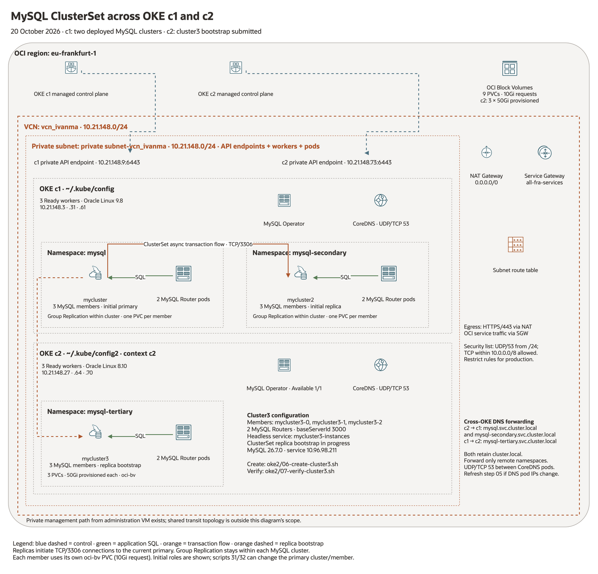
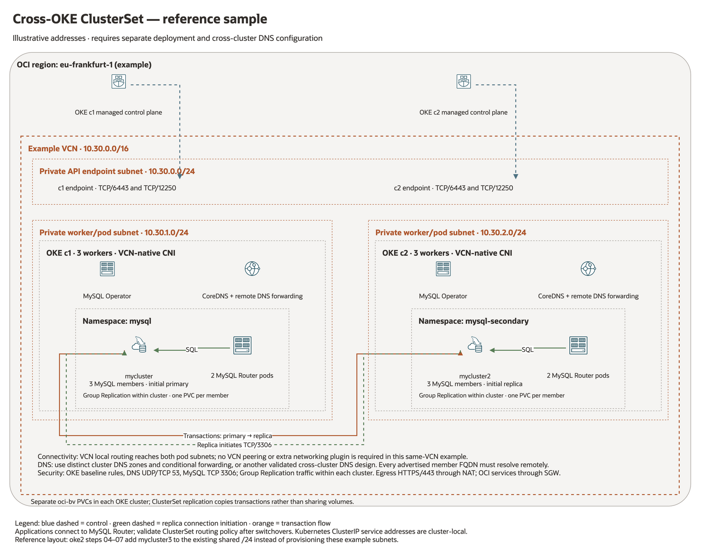

# MySQL InnoDB Cluster on Kubernetes — Linux 9

Numbered Bash scripts install the official MySQL Operator and create a MySQL
Community InnoDB Cluster on an existing Kubernetes environment. Run them on an
Oracle Linux 9, RHEL 9, Rocky Linux 9, or AlmaLinux 9 administration host, using
the account whose `kubectl` is already configured. The administration host does
not need to be a Kubernetes worker. Optional step 00 installs the MySQL Shell
client on the host; MySQL Server runs in Kubernetes.

Defaults: operator Helm chart **2.3.0**, MySQL/Router **26.7.0**, Helm **v4.3.1**,
three MySQL instances, two Routers, and a **10Gi ReadWriteOnce PVC per MySQL
instance**. Versions were checked against the official chart repository on
2026-10-20. Review compatibility before changing versions together.

## Deployment architecture



[Deployment diagram source](docs/diagrams/deployment.drawio)

Both MySQL clusters currently run in **OKE c1**, in namespaces `mysql` and
`mysql-secondary`. Each has three MySQL members and two Router pods; the
ClusterSet starts with `mycluster` as primary and `mycluster2` as replica.
Scripts 31 and 32 can change those roles. The operator manages the Kubernetes
resources; MySQL Group Replication operates within each database cluster and
asynchronous ClusterSet replication runs between them. Each MySQL member uses
its own `oci-bv` PVC.

OKE c2 shares the Frankfurt VCN and private subnet `10.21.148.0/24`.
Its three workers are Ready and its separate MySQL Operator is Available.
The diagram includes **`mysql-tertiary/mycluster3`**:
three MySQL members (`mycluster3-0`, `mycluster3-1`, `mycluster3-2`), two Routers,
three independent `oci-bv` PVCs requesting 10Gi each, and server IDs starting
at 3000. OCI provisioned each c2 volume at **50Gi**. Cluster3 bootstrap was
submitted on 2026-10-20; its three PVCs are Bound and pod initialization is
in progress. Its Router Service ClusterIP is `10.96.98.211` inside c2.

The [oke2 workflow](oke2/README.md#add-cluster3-in-oke-c2) adds cluster3 as a
replica of the existing ClusterSet's current primary. Its namespace remains
separate from the two c1 database namespaces. Both OKE clusters retain
`cluster.local`; namespace-specific CoreDNS forwarding supplies member name
resolution across clusters. The replica initiates TCP/3306 connections to the
source, then receives its transaction stream. Verify the active source and
read-only state with `oke2/07-verify-cluster3.sh`.

Private management access uses the existing network path. Its shared transit
topology is outside the diagram's Frankfurt network scope.

### Sample: a database cluster in each OKE cluster



[Cross-OKE sample source](docs/diagrams/cross-oke-sample.drawio)

This is an illustrative layout with example CIDRs. The scripts do not provision
these example networks. The [cluster3 workflow](oke2/README.md#add-cluster3-in-oke-c2)
adds a third MySQL cluster to the existing c2 network instead. Each OKE cluster needs its own operator, database
resources, credentials, and PVCs. In a shared VCN with VCN-native pod networking,
local VCN routing provides the IP path between the two pod subnets; permit the
required traffic in security lists/NSGs and any Kubernetes NetworkPolicies.
Additional VCN peering is unnecessary for that same-VCN design.

Cross-cluster DNS still needs explicit configuration. The two Kubernetes DNS
services do not automatically resolve each other's member names, and ClusterIP
services are local to each Kubernetes cluster. Use a validated DNS design with
unique cluster domains and conditional forwarding (or an equivalent approach),
and ensure every advertised MySQL member endpoint is reachable and resolvable
from the opposite cluster. Validate MySQL Operator/ClusterSet configuration for
that topology before deploying it. Root scripts 11–13 target two namespaces in one Kubernetes
cluster; the optional oke2 workflow uses distinct namespace DNS forwarding
across the existing clusters, which both retain `cluster.local`.

The replica initiates its connection to the primary on TCP/3306; transaction
data then flows from primary to replica. A Router or service endpoint alone
does not replace connectivity to the individual advertised members. After a
switchover, verify the new source with script 33 and check Router routing policy.

Diagrams use the official [OCI Library and Oracle architecture toolkit v24.2](https://docs.oracle.com/en-us/iaas/Content/General/Reference/graphicsfordiagrams.htm).
The generic official Container glyph represents Kubernetes operator and Router
pods; the MySQL glyph represents self-managed MySQL rather than a managed
HeatWave service. Oracle styling does not imply Oracle endorsement.

## Before starting

For access to a second OKE cluster, use the separate [oke2 scripts](oke2/README.md).
Steps 01–03 create `~/.kube/config2` with context `c2` and provide dedicated
kubectl/Helm wrappers, preserving the first cluster's `~/.kube/config`. Optional
[oke2 steps 04–07](oke2/README.md#add-cluster3-in-oke-c2) install its own MySQL
Operator and create `mysql-tertiary/mycluster3` as a replica of the existing
ClusterSet. These cross-OKE scripts include namespace-specific DNS forwarding.

- `kubectl` must be installed, connected, and able to reach the API server.
  Initial operator installation needs cluster administrator permissions for CRDs
  and RBAC. Run `kubectl config current-context` and `kubectl get nodes` first.
- The default placement requires three Ready, uncordoned Linux worker nodes
  without scheduling taints. Each MySQL pod requests 600m CPU and 1152Mi memory
  across its MySQL and sidecar containers; allow additional capacity for init
  containers, Routers, the operator, and Kubernetes itself. MySQL has a 2Gi
  memory limit and a 512Mi InnoDB buffer pool; tune these for your workload.
- Configure a working CSI provisioner and StorageClass. An empty `STORAGE_CLASS`
  uses the single default class. These scripts cannot choose a storage driver
  for an unknown Kubernetes platform. They do not install Kubernetes or storage.
- Pod networking and cluster DNS must work. Workers must pull images from
  `container-registry.oracle.com/mysql`. The administration host needs HTTPS
  access to `get.helm.sh` and `mysql.github.io`, plus configured DNF repositories.
- Have `sudo` access for steps 00/01 and for installing the Helm binary in step 02.
  Run scripts as your normal user; do not run the whole sequence with `sudo`.

On the supplied VM, use `/home/opc/mysqlk8s`. During the initial inspection,
neither `kubectl` nor Helm was on `opc`'s PATH. Step 02 installs Helm; install and
configure `kubectl` for your Kubernetes platform before step 03.

## Network ports and OCI security rules

Configure OCI NSGs or subnet security lists before deploying. For VCN-native
networking, Oracle's baseline requires stateful traffic between worker nodes
and between pods, including across workers. Keep those rules restricted to the
cluster's worker/pod CIDRs or NSGs. The flows below explain the ports used by
this setup; they supplement the full
[OKE network security requirements](https://docs.oracle.com/en-us/iaas/Content/ContEng/Concepts/contengnetworkconfig.htm).

| Source | Destination | Protocol / destination port | Purpose |
| --- | --- | --- | --- |
| Administration VM | Kubernetes API endpoint | TCP/6443 | kubectl and Helm. |
| Workers and pods | Kubernetes API endpoint | TCP/6443, TCP/12250 | OKE API and node/pod communication. |
| Kubernetes control plane | Workers | TCP/10250 | Kubelet access, including logs and exec. |
| Workers and pods | CoreDNS pods | **UDP/53 and TCP/53** | Cluster DNS, including operator startup. |
| Workers | Container registries | TCP/443 | Pull operator, MySQL, Router, and system images. |
| Administration VM | Helm/download endpoints and package repositories | TCP/443; repository-specific ports | Install prerequisites and download charts. |
| Your administration client | Administration VM | TCP/22 | SSH and the optional SSH tunnel. |

Apply destination ingress and matching source egress permissions wherever
egress is restricted. Use stateful rules with source port **All**; the port
numbers in the table are destination ports. Retain the remaining OKE platform
rules, including required ICMP traffic, from the linked baseline.

### Required DNS rule for this environment

The worker and pod subnet is `10.21.148.0/24`. In the OCI Console, open that
subnet's security list, or an NSG applied to the CoreDNS pod VNICs, and ensure
these **ingress** settings are present:

| Setting | UDP DNS rule | TCP DNS rule |
| --- | --- | --- |
| Stateless | No (stateful) | No (stateful) |
| Source type | CIDR | CIDR |
| Source CIDR | `10.21.148.0/24` | `10.21.148.0/24` |
| IP protocol | UDP (17) | TCP (6) |
| Source port range | All | All |
| Destination port range | `53` | `53` |

An existing rule covering the same traffic is sufficient. In this deployment,
TCP was already allowed; adding **UDP/53 from `10.21.148.0/24`** resolved the
operator startup failure. If workers and pods use separate subnets, use their
actual source CIDRs and apply the rules to the subnet/NSG receiving DNS traffic.
Allow DNS egress from the clients and CoreDNS forwarding to its upstream
resolver as well. Apply equivalent permissions if Kubernetes NetworkPolicies
restrict DNS traffic.

The DNS Service here is `10.96.5.5`, but VCN-native traffic ultimately reaches
the CoreDNS **pod IPs**. Base OCI rules on the actual pod/worker subnets or NSGs,
and allow communication across workers. Verify the current DNS endpoints with:

```bash
kubectl -n kube-system get service kube-dns
kubectl -n kube-system get pods -l k8s-app=kube-dns -o wide
kubectl -n kube-system get endpointslices -l kubernetes.io/service-name=kube-dns
```

Blocked UDP/53 can leave CoreDNS pods Ready while application DNS queries time
out. In this case the operator logged `Failed to detect cluster domain`, then
crashed; Helm subsequently reported `Progress deadline exceeded`. Test from an
application pod on another worker, since same-worker traffic can hide missing
VCN permissions. After the operator is running, check name resolution with:

```bash
kubectl -n mysql-operator exec deployment/mysql-operator -- \
  mysqlsh --py -e 'import socket; print(socket.gethostbyname("kubernetes.default.svc.cluster.local"))'
```

### Shared subnet capacity and NotReady workers

The shared API/worker/pod subnet was expanded from `/25` to
**`10.21.148.0/24`** on 2026-10-20. The second cluster's CNI reported
`FailedToCreatePrivateIP` / `FailedToAttachVNIC`, explicitly stating that all
**125 non-reserved addresses** in the former `/25` were allocated. OCI inventory
confirmed 125 allocated IPs (14 primary and 111 secondary) at diagnosis.
The node condition consequently reported `NetworkPluginNotReady`, and CoreDNS
could not schedule on the NotReady workers.

Updating the DNS rule's source CIDR alone does not increase subnet capacity.
Both the subnet CIDR and the UDP/53 source range now cover `/24`. A `/24` has
253 usable IPv4 addresses in OCI. VCN-native CNI preallocates pod addresses,
so capacity depends on worker/node-pool settings as well as running pod count;
allow headroom for node replacement, scaling, endpoints, and other consumers.
See [OCI VCN-native pod networking](https://docs.oracle.com/en-us/iaas/Content/ContEng/Concepts/contengpodnetworking_topic-OCI_CNI_plugin.htm).

After expansion, all three c2 workers became **Ready** and all three
NativePodNetworks reported **SUCCESS / COMPLETED**, without node recreation.
CoreDNS also started successfully. To monitor network health:

```bash
cd ~/mysqlk8s/oke2
./kubectl.sh get nativepodnetworks
./kubectl.sh get nodes -w
./kubectl.sh -n kube-system get pods -o wide
./kubectl.sh get events -A --field-selector type=Warning --sort-by=.lastTimestamp
```

Historical exhaustion events can remain after the CIDR changes. Check their
last occurrence and the current NativePodNetwork state. Do not remove the
NotReady taint manually: the node needs working CNI before workloads can run.

### MySQL and Router ports

Allow the following internal flows when applying additional network restrictions.
Service ports can map to different Router pod ports, so permitting only the
client-facing `3306` is insufficient for a narrowly filtered pod network.

| Source | Destination | TCP port | Purpose |
| --- | --- | --- | --- |
| Application pods | MySQL cluster Service | `3306` | Read/write SQL; maps to Router pod `6446`. |
| Application pods | MySQL cluster Service / Router pods | `6447` | Read-only SQL. |
| Application pods | Router pods | `6446` | Read/write SQL after Service translation. |
| Operator, Router, and database member pods | MySQL server pods | `3306` | Administration, SQL, and member recovery. |
| Database member pods | Other database member pods | `33061` | Group Replication when using the XCOM communication stack; retain if that stack is selected. |
| X Protocol clients | MySQL cluster Service | `33060` | Optional X Protocol; maps to Router pod `6448`. |
| X Protocol clients | Router pods | `6448`, `6449` | Optional X Protocol read/write and read-only. |
| X Protocol clients / Router | MySQL server pods | `33060` | Optional direct/backend X Protocol. |

For replication using the MYSQL communication stack, allow the configured MySQL
server port between members (normally `3306`). See the
[MySQL Operator Service documentation](https://dev.mysql.com/doc/mysql-operator/en/mysql-operator-innodbcluster-service.html)
and inspect `kubectl -n mysql describe service mycluster` for the actual
Service-to-pod port mappings. These ports stay inside the cluster with the
default `ClusterIP` configuration.

Step 08 binds the local MySQL port to `127.0.0.1` on the administration VM.
Using its SSH tunnel requires inbound SSH to that VM, with no public MySQL
ingress rule. `LOCAL_MYSQL_PORT` changes the local listening port; the Router
Service destination stays the same.

## Configure and run

Step 00 optionally installs MySQL Shell on the administration host, using DNF
to install the official EL9 MySQL Yum repository setup RPM and then
`mysql-shell` from **`mysql-tools-innovation-community`**. It refreshes metadata
and installs the latest available Innovation Shell release on each run,
including upgrading an older installed Shell. The tools Innovation channel
remains enabled for future updates. Other tools channels are disabled to select
one release track; server repository selection is left as supplied by the
repository configuration. The host Shell version is independent of the pinned
MySQL versions running in Kubernetes. See the
[official MySQL Yum repository guide](https://dev.mysql.com/doc/mysql-yum-repo-quick-guide/en/).

```bash
cd ~/mysqlk8s
cp -n config.env.example config.env
chmod 600 config.env
vi config.env

./00-install-mysqlsh.sh
./01-install-prerequisites.sh
./02-install-helm.sh
./03-check-kubernetes.sh
./04-install-mysql-operator.sh
./05-create-mysql-cluster.sh
./06-verify-mysql-cluster.sh
```

Stop if a step fails. The steps are intentionally separate so failures can be
resolved before continuing. Set `KUBE_CONTEXT` in `config.env` to pin all steps
to the same cluster. Otherwise each step uses the current context and displays it.
`MYSQLK8S_CONFIG=/absolute/path/config.env` selects an alternative configuration.
The configuration is sourced as trusted Bash code. Its settings override exported
environment variables; defaults apply to unset settings.

| Step | Action |
| --- | --- |
| `00-install-mysqlsh.sh` | Optional host MySQL Shell: installs the official MySQL Yum repository, selects the Innovation tools channel, and installs/updates `mysql-shell` with DNF. |
| `01-install-prerequisites.sh` | Installs Linux 9 local utilities through DNF. |
| `02-install-helm.sh` | Downloads Helm for amd64/arm64, checks SHA256, and installs `/usr/local/bin/helm`. |
| `03-check-kubernetes.sh` | Checks API connectivity, worker placement, StorageClass selection, and basic installation permissions. |
| `04-install-mysql-operator.sh` | Adds the official Helm repository, installs the pinned operator chart, and waits for its Deployment and CRD. |
| `05-create-mysql-cluster.sh` | Creates the workload namespace and root Secret, validates and applies the cluster manifest. |
| `06-verify-mysql-cluster.sh` | Waits for `ONLINE`, all configured MySQL members, and ready MySQL/Router workloads. Prints diagnostics on failure. |
| `07-connect-mysql.sh` | Optional interactive MySQL Shell through Router, using the existing sidecar container. |
| `08-port-forward-mysql.sh` | Optional foreground port forward, bound to `127.0.0.1`. |

Step 04 contains the Helm repository/chart installation commands. Step 05 uses
the operator's `mysql.oracle.com/v2` `InnoDBCluster` custom resource through
`kubectl`; a second Helm chart for the database is unnecessary. The generated
manifest is `generated/innodbcluster.json` (Kubernetes accepts JSON and YAML).
Helm and kubectl use the same selected context. A global operator is installed;
do not change its topology or add competing operators to the same cluster.

For a one-worker lab, set these in `config.env` before starting:

```bash
MYSQL_INSTANCES=1
MYSQL_ROUTER_INSTANCES=1
```

Alternatively, `MYSQL_ANTI_AFFINITY=preferred` permits several MySQL instances on
one worker. Such a setup cannot survive loss of that worker. Default required
anti-affinity separates database members by worker, but does not guarantee
separate availability zones. Router placement uses the operator defaults.

## Credentials and reruns

Step 05 prompts twice for a root password of at least 12 characters. For an
unattended first deployment, set `MYSQL_ROOT_PASSWORD_FILE` to a protected
existing file; its trailing newline is removed. Store that file outside this
repository. Passwords are passed through temporary files with restrictive
permissions, removed on exit, and are not passed as command arguments or saved
in Helm values or the generated manifest. Kubernetes stores the resulting
Secret; restrict Secret access and configure encryption at rest as appropriate.

Existing root Secrets are reused, so rerunning step 05 does not reset a database
password. If a cluster exists but the selected Secret is missing, the script
stops so the original Secret can be restored. Root is created with host `%`, as
in the upstream example, to allow access through Router. Create application
accounts with appropriate privileges after deployment.

Step 04 reuses an already deployed operator release at the configured chart
version. It stops on a failed, pending, or differently versioned release, and
does not perform an implicit operator upgrade. If Helm is already installed,
step 02 requires it to match `HELM_VERSION`; set that configuration to your
chosen installed version rather than overwriting the binary. The default Helm
release has embedded SHA256 pins; other versions use their published checksums.

Reapplying step 05 reconciles the configured custom resource. Keep the original
cluster identity, Secret, StorageClass, and PVC settings stable. Changing the
configuration is not a general migration, password-rotation, volume-resize, or
upgrade procedure. The scripts never delete a cluster, Secret, or PVC.

## Add a second namespace and a ClusterSet replica

Steps 11-13 extend the existing cluster with a second InnoDB Cluster in another
namespace, using the same Kubernetes environment and existing operator:

| Role | Namespace / cluster | Default members |
| --- | --- | --- |
| ClusterSet primary | `mysql/mycluster` | Existing 3 MySQL instances and 2 Routers. |
| ClusterSet replica (secondary cluster) | `mysql-secondary/mycluster2` | Additional 3 MySQL instances and 2 Routers. |

The operator release used here automatically creates a ClusterSet when it
initializes a primary InnoDB Cluster. These scripts retain that ClusterSet's
existing name, normally `mycluster`. Step 12 specifies **`spec.initDB.clusterSet`**
on the new cluster, so the operator clones the primary and bootstraps a replica
member. It does not create a separate standalone cluster and attempt to attach
it afterward. This follows the
[release's ClusterSet tests](https://github.com/mysql/mysql-operator/blob/26.7.0-2.3.0/tests/e2e/mysqloperator/clusterset/clusterset_t.py)
and [CRD schema](https://github.com/mysql/mysql-operator/blob/26.7.0-2.3.0/deploy/deploy-crds.yaml).

```bash
cd ~/mysqlk8s
cp -n clusterset.env.example clusterset.env
chmod 600 clusterset.env
vi clusterset.env

./11-check-clusterset.sh
./12-create-replica-cluster.sh
./13-verify-clusterset.sh
```

Run these after steps 04-06 have completed successfully. Stop if a step fails.
`config.env` supplies the Kubernetes context and operator namespace;
`clusterset.env` supplies the primary and replica identities and settings.
`MYSQLK8S_CLUSTERSET_CONFIG=/absolute/path/clusterset.env` selects an alternative
ClusterSet configuration file. A global operator already watches both
namespaces, so a second operator installation is unnecessary.

| Script | Action |
| --- | --- |
| `11-check-clusterset.sh` | Checks native CRD support, operator watch scope, primary readiness and its current ClusterSet role, worker placement, StorageClass, DNS, and server-ID ranges. Reads existing resources and AdminAPI status. |
| `12-create-replica-cluster.sh` | Repeats prerequisite checks, creates the replica namespace and its root Secret, validates the replica CR against the API server, then submits native ClusterSet bootstrap. |
| `13-verify-clusterset.sh` | Waits for all replica members and Routers, then verifies AdminAPI reports the expected primary and replica, a `HEALTHY` ClusterSet, and `super_read_only=1` on the replica's sampled member. Prints status and failure diagnostics. |

The replica inherits the primary's exact MySQL version and edition. These
starter scripts require self-signed TLS; managed certificates need corresponding
replica certificate Secrets and a separately configured TLS setup. The replica
uses `baseServerId=2000`, separate from the primary's default `1000`. Preflight
rejects overlapping server-ID ranges. If extending this beyond two clusters,
allocate a different range to every cluster and read-replica group.

The primary root credentials are copied into a **new namespace-local Secret**
for replica initialization. Clone recovery also copies the primary's accounts
and data, so use the same root password on both clusters. The scripts transfer
credentials through memory/stdin; they do not print them or write them into the
manifest or shell arguments. The generated replica manifest is saved at
`generated/replica-innodbcluster.json`.

The replica name and namespace must be fresh. Step 12 rejects orphaned datadir
PVCs, independent existing clusters, changed bootstrap settings, and conflicting
Secrets. A matching existing replica is reused without changing it; use step 13
to recheck health. The scripts preserve the current primary and do not perform
promotion, switchover, failover, or deletion.

Allow capacity for the additional three database pods, two Routers, and three
PVCs. The default affinity separates the replica's members across three workers;
those workers may also host the original cluster. Worker-count checks do not
guarantee sufficient free CPU, memory, volume-attachment slots, or subnet IPs.
Choose replica PVC sizes large enough for the primary's data and expected growth;
cloning can take longer than normal empty-cluster initialization.

Cross-namespace networking must allow UDP/TCP DNS and TCP/3306 between members,
plus any Group Replication ports required by the selected stack. Preserve the
OKE internal pod networking rules described above. Namespace isolation through
NetworkPolicies must explicitly allow the necessary traffic in both directions.

After step 13, both namespaces have a MySQL Service. A Router in the replica's
namespace can still route to the ClusterSet primary according to ClusterSet
routing policy; do not assume its namespace alone selects local replica reads.
The verification script connects to database members directly for its role and
read-only checks. Configure Router targeting separately if local replica reads
are required.

ClusterSet replication between the two InnoDB Clusters is **asynchronous**.
The replica can lag behind the primary. Two namespaces sharing the same
Kubernetes cluster and workers do not provide isolation from a Kubernetes-wide
or site-wide outage, and they do not replace backups.

## Operational switchovers and replication channels

Steps 31-33 use the same `config.env` and `clusterset.env`. The two configured
cluster identities stay fixed even when their live roles change: the
`PRIMARY_MYSQL_*` settings identify the original cluster, and `REPLICA_MYSQL_*`
identify the second cluster. Do not swap those settings after a switchover.
Steps 11-13 remain bootstrap checks expecting the original role assignment;
use steps 31-33 for operations after role changes.

| Script | Operation |
| --- | --- |
| `31-toggle-clusterset-primary.sh` | Detects which of the two clusters is currently primary and switches the primary role to the other cluster. Each successful invocation toggles the direction. |
| `32-rotate-primary-node.sh` | Detects the current primary cluster, selects its ONLINE secondary member with the lowest numeric pod ordinal, and elects that member as the new primary node. The ClusterSet primary cluster stays the same. |
| `33-replication-channel-status.sh` | Queries every member of both clusters for asynchronous channel status, actual source identity, group roles, and automatic connection-failover candidates. Read-only. |

Preview the selected target before an operation, or run the script directly:

```bash
./31-toggle-clusterset-primary.sh --dry-run
./31-toggle-clusterset-primary.sh

./32-rotate-primary-node.sh --dry-run
./32-rotate-primary-node.sh
```

Steps 31/32 require both configured clusters to be fully ONLINE and the
entire ClusterSet to be HEALTHY, including any additional replicas. The
primary must remain within the configured c1 pair. They recheck live roles immediately before
submitting one AdminAPI operation. Step 31 calls `set_primary_cluster()` for a
controlled switchover; it synchronizes the target and demotes the original
primary to a replica. Step 32 calls `set_primary_instance()` within the live
primary cluster. For example, if pod `-0` is PRIMARY, step 32 selects ONLINE
secondary `-1`; on the next run it normally selects `-0` if that pod is now the
first ONLINE secondary. Pod ordinals do not permanently define database roles.

`--timeout 120` is the default synchronization wait for step 31 and the
`runningTransactionsTimeout` for step 32. For step 32, MySQL can roll back
transactions still running when that wait expires so the primary election can
finish. Plan for brief write interruption and client reconnection. Routers
configured to follow the ClusterSet primary refresh their routing after the
change; Routers pinned to a specific cluster retain that targeting policy.
See [controlled switchovers](https://dev.mysql.com/doc/mysql-shell/26.7/en/innodb-clusterset-switchover.html)
and [ClusterSet Router behavior](https://dev.mysql.com/doc/mysql-shell/26.7/en/innodb-clusterset-router.html).

`--dry-run` reads topology and previews the selection without submitting an
AdminAPI change. An actual run verifies the expected new roles after the
operation. The scripts do not force emergency failover, invalidate clusters,
retry a submitted change, or automatically roll it back. If an operation errors
or times out after submission, inspect step 33 before retrying: another toggle
after a successful but unconfirmed change would switch back.

A shared local lock serializes steps 31 and 32 in this workspace. Coordinate
with administrators using other hosts or tools; the lock does not cover their
operations. Passwords are read from the relevant Kubernetes Secret and passed
to the sidecar's MySQL Shell through stdin, without password arguments or files.

Inspect the replication connection once or watch it after a switchover:

```bash
./33-replication-channel-status.sh
./33-replication-channel-status.sh --watch --interval 5
./33-replication-channel-status.sh --json
./33-replication-channel-status.sh --watch --json --interval 5
```

The report shows the live ClusterSet primary cluster/member, then each database
pod's group role, `super_read_only`, channel name, configured source host/port,
receiver and applier state, lag, errors, and candidate sources. It maps the
receiver's **SOURCE_UUID** back to Group Replication member hostnames and compares
it with the current primary member. `MATCH` means a connected receiver points
to the expected primary, `DIFFERENT SOURCE` indicates another source, and
`NOT CONNECTED` distinguishes a stopped/reconnecting receiver from an active
connection. `UNKNOWN` means its source identity could not be mapped.

The replica cluster's group PRIMARY normally runs the active ClusterSet receiver;
its group SECONDARY members can have standby/stopped channels. The ClusterSet
primary normally has no incoming asynchronous channel. After step 32, watch
the replica receiver's source UUID/endpoint change to the new primary node.
Reconnection takes time; transient nonmatching or reconnecting states are shown
without modifying channels. Each watch iteration queries all members, then
waits the configured interval. Ctrl-C stops monitoring. JSON mode includes
raw selected channel fields, connection state, candidate sources, and partial
query errors for further inspection.

## Connect and check SQL

For an independent MySQL Shell pod inside the cluster, use step 91. It has
Kubernetes DNS and pod-network access, so AdminAPI can reach the individual
database members advertised in cluster metadata without host port forwarding.

```bash
./91-mysqlsh.sh
./91-mysqlsh.sh --replica
./91-mysqlsh.sh --namespace mysql --cluster mycluster --member 1
```

The default connects directly to member `mycluster-0` in the configured primary
namespace. `--replica` selects the replica defined in `clusterset.env`. The
script displays database pod IPs and the selected member's DNS endpoint, then
prompts for the MySQL password. Pod ordinal 0 is a connection entry point;
primary election can select a different member.

The client pod uses the selected database's existing operator sidecar image,
with `ClusterFirst` DNS and an unprivileged user. It mounts temporary storage
for Shell configuration, with no Kubernetes API token or database volumes.
Normal exit removes the client pod. Allow scheduling capacity for its 50m CPU
and 128Mi memory requests, plus DNS and database connectivity if NetworkPolicies
restrict the selected namespace.

Inside the default JavaScript Shell session, try:

```javascript
dba.getCluster().status({extended: 1})
dba.getClusterSet().status({extended: 1})
```

For a Shell prompt without an initial database connection, or a batch DNS check:

```bash
./91-mysqlsh.sh --no-connect
./91-mysqlsh.sh --no-connect -- --py -e \
  'import socket; print(socket.gethostbyname("mycluster-0.mycluster-instances.mysql.svc.cluster.local"))'
```

Use `--user NAME` for a different MySQL account. Arguments after `--` are passed
to `mysqlsh`, for example `-- --sql` or `-- --py`. `--dry-run` shows the client
pod manifest without creating it. Use `\quit` to exit an interactive session.

Alternatively, step 07 uses the Shell already in an existing sidecar and connects
through Router:

```bash
./07-connect-mysql.sh
```

Enter the root password, then run:

```sql
SELECT @@hostname, @@version, @@read_only;
SELECT MEMBER_HOST, MEMBER_STATE, MEMBER_ROLE
FROM performance_schema.replication_group_members;
```

Applications inside Kubernetes use `mycluster.mysql.svc:3306` for read/write or
`mycluster.mysql.svc:6447` for read-only traffic, with the default names. The
Service is `ClusterIP`. Router routes writes to the current primary; pod `-0`
is not assumed to remain the primary.

For a client on the administration host, run `./08-port-forward-mysql.sh`, then
in another terminal on the same host:

```bash
mysql -h 127.0.0.1 -P 3306 -u root -p
```

With the MySQL Shell installed by step 00, use this command instead:

```bash
mysqlsh --sql --host 127.0.0.1 --port 3306 --user root --password
```

This requires a separately installed MySQL client only for the port-forward
option; step 07 uses the client already in Kubernetes. `LOCAL_MYSQL_PORT` can
change the local port. From your laptop, keep step 08 running on the VM and add
an SSH tunnel in another laptop terminal:

```bash
ssh -i ~/key/id_rsa_bb.key -N -L 13306:127.0.0.1:3306 opc@132.145.60.181
mysql -h 127.0.0.1 -P 13306 -u root -p
```

## Operations

The starter configuration uses self-signed TLS, without verified server identity.
For production, configure managed TLS certificates, application credentials,
backup profiles/schedules and tested restores, monitoring, and appropriate
NetworkPolicies. Three database members provide quorum but do not replace a
backup. Adapt resource and storage settings before loading substantial data.

Step 06 prints pods, PVCs and recent events on failure. Useful commands with the
default names are:

```bash
kubectl -n mysql get innodbclusters,pods,pvc,services
kubectl -n mysql get events --sort-by=.lastTimestamp
kubectl -n mysql-operator logs deployment/mysql-operator --tail=100
kubectl -n mysql describe pod mycluster-0
```

Pending PVCs usually require checking the StorageClass/CSI provisioner; with
`WaitForFirstConsumer`, binding may wait until scheduling. Pending pods can also
indicate insufficient workers/resources or affinity constraints. Image pull
errors require worker registry access. A preflight pass does not prove that
storage provisioning, image pulls, DNS, and pod connectivity work end to end.

## Sources and validation

- [Official MySQL Operator repository](https://github.com/mysql/mysql-operator)
- [Operator installation using Helm](https://dev.mysql.com/doc/mysql-operator/en/mysql-operator-installation-helm.html)
- [Custom resource properties](https://dev.mysql.com/doc/mysql-operator/en/mysql-operator-properties.html)
- [Pinned upstream operator release](https://github.com/mysql/mysql-operator/tree/26.7.0-2.3.0)
- [Helm binary installation](https://helm.sh/docs/intro/install/)

Run `python3 tests/test_scripts.py` for local isolated checks with mocked
Kubernetes/Helm commands. These checks do not install software or contact a
cluster. A live deployment is still needed to verify the target environment.
Run `python3 tests/test_clusterset.py` for ClusterSet bootstrap, credential,
identity, storage, and rerun safeguards without creating a second cluster.
Run `python3 tests/test_operations.py` for toggle direction, member selection,
health guards, mutation-free previews, and actual replication-source matching.
