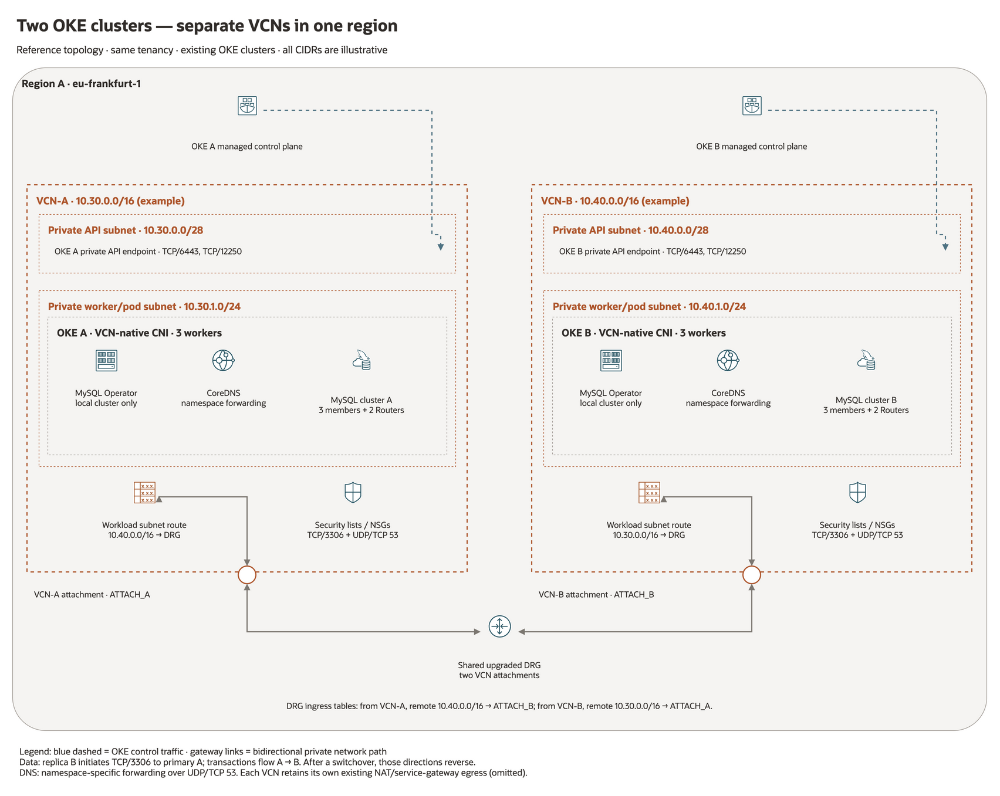
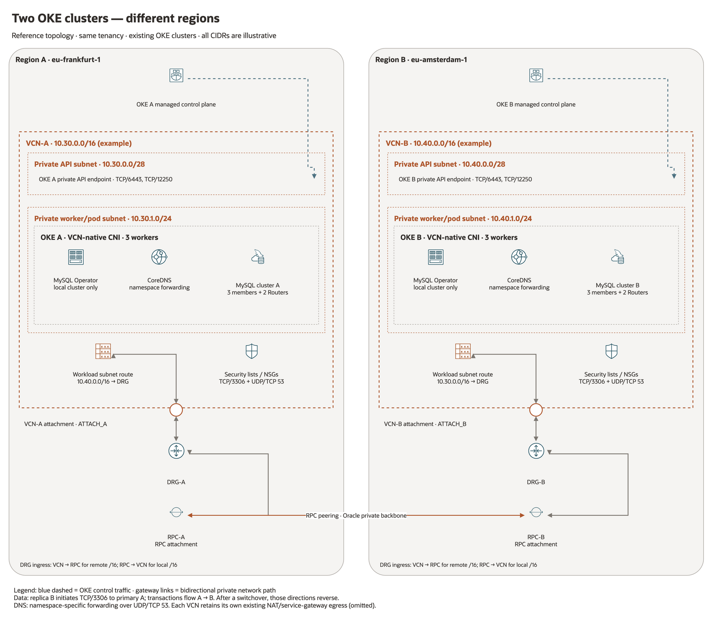

# Connecting two OKE clusters: network changes and commands

Addresses and resource names in this public reference are illustrative; live inventory is kept in ignored `internal_doc/`.

This guide connects **individual MySQL and CoreDNS pods** between two existing
OKE clusters. It covers a shared VCN, separate VCNs in one region, and VCNs in
different regions. It assumes **OCI VCN-native pod networking**, IPv4, and
same-tenancy administration. Existing OKE control-plane, storage, registry, and
internet/service-gateway access must already work.

The OCI CLI examples below are **instructions to execute in your environment**;
creating this document has not created or changed VCNs, DRGs, RPCs, or rules.
Replace the example OCIDs. Run the shared preparation first, then **one** of
the separate-VCN scenarios. They are alternatives, not a single script to run
from top to bottom. The shared-VCN lab does not need either peering scenario.

## 1. Choose the connectivity model

| OKE placement | Private VCN connectivity | Changes required |
| --- | --- | --- |
| Same region, same VCN | VCN local routing | Security rules, cross-cluster DNS, and workload checks. No DRG/RPC is needed for this path. |
| Same region, different VCNs | Two VCN attachments on one upgraded DRG | VCN subnet routes, DRG ingress routing, security rules, and DNS. LPG peering is an alternative for a simple pair. |
| Different regions | Each VCN attached to its regional DRG; the DRGs connected through two peered RPCs | Both VCN attachments, both RPC attachments, RPC peering, both directions of VCN/DRG routing, security rules, and DNS. |

Region equality does **not** establish connectivity between different VCNs.
A VCN is regional, so two OKE clusters in different regions cannot share a VCN.
See Oracle's [same-region DRG design](https://docs.oracle.com/en-us/iaas/Content/Network/Tasks/scenario_d.htm)
and [cross-region DRG/RPC design](https://docs.oracle.com/en-us/iaas/Content/Network/Tasks/scenario_e.htm).

No additional Kubernetes network plugin is required for the VCN-native design
here: pod addresses come from OCI subnets and can be reached through VCN
routing/peering. Worker VCN connectivity alone does not make a flannel overlay's
pod addresses reachable; that topology needs a separate pod-network design.
[OCI VCN-native networking](https://docs.oracle.com/en-us/iaas/Content/ContEng/Concepts/contengpodnetworking_topic-OCI_CNI_plugin.htm)
describes direct pod access.

**Keep all communicating VCN/worker/pod address ranges non-overlapping.**
Also check them against administration, on-premises, VPN, and Kubernetes
service ranges. ClusterIP services remain local to their Kubernetes cluster;
do not advertise the service CIDR through a DRG. The existing clusters can both
use their current service range because this design exchanges pod addresses,
not ClusterIPs. Avoid overlapping service ranges in new designs where practical.

## 2. Current deployment: both OKE clusters in one VCN

Deployment-specific architecture and live inventory are kept in the local private documentation.

| Item | c1 | c2 |
| --- | --- | --- |
| Region | eu-frankfurt-1 | eu-frankfurt-1 |
| VCN | example-vcn, 10.60.10.0/24 | Same VCN |
| Shared private API/worker/pod subnet | 10.60.10.0/24 | Same subnet |
| Private API | 10.60.10.9:6443 | 10.60.10.73:6443 |
| Worker IPs | 10.60.10.3, .31, .61 | 10.60.10.27, .64, .70 |
| MySQL namespaces | mysql; mysql-secondary | mysql-tertiary |
| MySQL clusters | mycluster; mycluster2 | mycluster3 |
| Kubeconfig | ~/.kube/config | ~/.kube/config2, context c2 |

For this lab, the changes that enabled communication were:

1. Expand the shared subnet from `/25` to `/24`. The former subnet's **125**
   usable IPs were exhausted during c2 CNI initialization. A `/24` provides
   **253** usable addresses in OCI. CNI preallocation, endpoints, and worker
   replacement all consume capacity beyond the currently running pod count.
2. Allow **UDP/53 from 10.60.10.0/24**, in addition to TCP DNS and MySQL traffic.
   TCP traffic was already permitted by an existing broader lab rule.
3. Forward the remote database namespaces through the opposite cluster's
   CoreDNS pods, in both directions. VCN DNS alone does not resolve Kubernetes
   `.svc.cluster.local` names.
4. Install a separate MySQL Operator in c2 and create cluster3 there.

Do not add a DRG or RPC for this existing c1-to-c2 path. A NAT gateway is for
outbound access, not for making the clusters' private pod addresses mutually
reachable. The administration VM's existing private transit path is separate
from this same-VCN workload path.

From the administration VM, check and configure the existing lab with:

```bash
cd ~/mysqlk8s
kubectl --kubeconfig "$HOME/.kube/config" --context example-c1-context get nodes
kubectl --kubeconfig "$HOME/.kube/config2" --context c2 get nodes

cd oke2
./05-configure-cross-cluster-dns.sh --dry-run
./05-configure-cross-cluster-dns.sh
./07-verify-cluster3.sh
```

Step 07 expects cluster3 to be a **replica**. If you intentionally promote it
with root step 31, inspect ClusterSet status through MySQL Shell instead.

## 3. Preparation for either separate-VCN example

The remaining diagrams use **example networks**, not the shared-VCN lab CIDRs.
Both OKE clusters and their subnets already exist. This guide provisions the
interconnection; it does not create or migrate Kubernetes clusters.

| Resource | Site A | Site B |
| --- | --- | --- |
| VCN CIDR | 10.30.0.0/16 | 10.40.0.0/16 |
| Private API subnet | 10.30.0.0/28 | 10.40.0.0/28 |
| Private worker/pod subnet | 10.30.1.0/24 | 10.40.1.0/24 |
| Same-region example | Frankfurt | Frankfurt |
| Cross-region example | Frankfurt | Amsterdam |

Use your real CIDRs throughout. If workers and pods use separate subnets, add
routes to every **originating pod/CoreDNS subnet route table**; add worker
subnet routes too where host-network traffic needs the remote networks.
Keep the OKE baseline rules for each local cluster intact.

Use Bash on the Linux 9 administration host, with authenticated OCI CLI,
Python 3, kubectl, and jq. `sudo dnf install -y jq` installs jq if needed.
The account needs permissions to manage VCN attachments, DRGs, RPCs, route
tables, and security rules, plus Kubernetes permissions for CoreDNS ConfigMaps.
For example, an administrator can grant a suitable network group
`manage virtual-network-family` in the relevant network compartment. This
example assumes one compartment and tenancy; cross-tenancy peering also needs
explicit requestor/acceptor authorization in both tenancies. Follow the
[OCI networking IAM reference](https://docs.oracle.com/en-us/iaas/Content/Identity/Reference/corepolicyreference.htm)
and do not assume a Kubernetes administrator automatically has OCI network rights.

Set variables in a new Bash terminal:

```bash
set -euo pipefail
export COMPARTMENT_ID='ocid1.compartment.oc1..REPLACE_ME'
export REGION_A='eu-frankfurt-1'
export REGION_B='eu-frankfurt-1' # Same-region; change in the cross-region section.
export VCN_A='ocid1.vcn.oc1.eu-frankfurt-1.REPLACE_ME'
export VCN_B='ocid1.vcn.oc1.eu-frankfurt-1.REPLACE_ME'
export CIDR_A='10.30.0.0/16'
export CIDR_B='10.40.0.0/16'
export POD_CIDR_A='10.30.1.0/24'
export POD_CIDR_B='10.40.1.0/24'
export POD_SUBNET_A='ocid1.subnet.oc1.eu-frankfurt-1.REPLACE_ME'
export POD_SUBNET_B='ocid1.subnet.oc1.eu-frankfurt-1.REPLACE_ME'
export KCFG_A="$HOME/.kube/config"
export KCFG_B="$HOME/.kube/config2"
export CTX_A='example-c1-context' # Replace for your first cluster.
export CTX_B='c2'
export NET_STATE="$HOME/mysqlk8s/generated/oke-networking-$(date -u +%Y%m%dT%H%M%SZ)"
mkdir -p "$NET_STATE"
chmod 700 "$NET_STATE"
umask 077
```

For the cross-region alternative, change REGION_B **and every B resource OCID**
to the actual Amsterdam resources **before** making inventory calls.

Inventory both networks, their attached DRGs, and the workload subnet rules:

```bash
oci network vcn get --region "$REGION_A" --vcn-id "$VCN_A"
oci network vcn get --region "$REGION_B" --vcn-id "$VCN_B"
oci network drg-attachment list --region "$REGION_A" \
  --compartment-id "$COMPARTMENT_ID" --attachment-type ALL --all
oci network drg-attachment list --region "$REGION_B" \
  --compartment-id "$COMPARTMENT_ID" --attachment-type ALL --all

oci network subnet get --region "$REGION_A" --subnet-id "$POD_SUBNET_A" \
  --output json > "$NET_STATE/subnet-a.json"
oci network subnet get --region "$REGION_B" --subnet-id "$POD_SUBNET_B" \
  --output json > "$NET_STATE/subnet-b.json"
RT_A=$(jq -er '.data["route-table-id"]' "$NET_STATE/subnet-a.json")
RT_B=$(jq -er '.data["route-table-id"]' "$NET_STATE/subnet-b.json")
jq '.data["security-list-ids"]' "$NET_STATE/subnet-a.json"
jq '.data["security-list-ids"]' "$NET_STATE/subnet-b.json"
```

**A VCN can attach to only one DRG.** The creation examples below are for
previously unattached VCNs and newly created, dedicated routing tables. If a
VCN already uses a DRG, retain that attachment and integrate the remote routes
with its current network design. Do not detach it, move it to a new DRG, or
replace its ingress table with the isolated example table: that can remove
existing on-premises/transit connectivity. See
[DRG attachment behavior](https://docs.oracle.com/en-us/iaas/Content/Network/Tasks/drg-create-attachment.htm).

Define these helpers in the same terminal. They make the creation commands
below shorter while showing exactly which OCI operations run:

```bash
new_drg() {
  oci network drg create --region "$1" --compartment-id "$COMPARTMENT_ID" \
    --display-name "$2" --wait-for-state AVAILABLE --query data.id --raw-output
}
new_drg_table() {
  oci network drg-route-table create --region "$1" --drg-id "$2" \
    --display-name "$3" --query data.id --raw-output
}
attach_vcn() {
  oci network drg-attachment create --region "$1" --drg-id "$2" \
    --network-details "$(jq -cn --arg id "$3" '{type:"VCN",id:$id}')" \
    --drg-route-table-id "$4" --wait-for-state ATTACHED \
    --query data.id --raw-output
}
drg_route() {
  oci network drg-route-rule add --region "$1" --drg-route-table-id "$2" \
    --route-rules "$(jq -cn --arg cidr "$3" --arg hop "$4" \
      '[{destination:$cidr,destinationType:"CIDR_BLOCK",nextHopDrgAttachmentId:$hop}]')"
}
```

These use [attachment creation](https://docs.oracle.com/en-us/iaas/tools/oci-cli/latest/oci_cli_docs/cmdref/network/drg-attachment/create.html),
[dedicated DRG route tables](https://docs.oracle.com/en-us/iaas/tools/oci-cli/latest/oci_cli_docs/cmdref/network/drg-route-table/create.html),
and [additive static DRG rules](https://docs.oracle.com/en-us/iaas/tools/oci-cli/latest/oci_cli_docs/cmdref/network/drg-route-rule/add.html).
Resource creation is not a rerun/upgrade operation; save returned OCIDs and
inspect existing resources before retrying after a timeout.

## 4. Same region, separate VCNs: one upgraded DRG



[Same-region diagram source](diagrams/network-same-region.drawio)

Use **one upgraded DRG** for both VCNs. Create an ingress routing table for each
VCN attachment, then route the remote VCN CIDR to the opposite attachment.
A DRG ingress table decides what happens to traffic **entering** that DRG on
its assigned attachment. A subnet route table separately decides how traffic
leaves the subnet. Both layers must be configured.

Run after section 3, only for previously unattached example VCNs:

```bash
REGION_B="$REGION_A"
DRG_A=$(new_drg "$REGION_A" 'oke-shared-drg')
DRG_B="$DRG_A"
DRG_FROM_A=$(new_drg_table "$REGION_A" "$DRG_A" 'from-vcn-a')
DRG_FROM_B=$(new_drg_table "$REGION_A" "$DRG_A" 'from-vcn-b')
ATTACH_A=$(attach_vcn "$REGION_A" "$DRG_A" "$VCN_A" "$DRG_FROM_A")
ATTACH_B=$(attach_vcn "$REGION_A" "$DRG_A" "$VCN_B" "$DRG_FROM_B")
drg_route "$REGION_A" "$DRG_FROM_A" "$CIDR_B" "$ATTACH_B"
drg_route "$REGION_A" "$DRG_FROM_B" "$CIDR_A" "$ATTACH_A"
```

Expected forwarding state:

| Table used by ingress attachment | Destination | Next hop |
| --- | --- | --- |
| VCN-A attachment: DRG_FROM_A | 10.40.0.0/16 | ATTACH_B |
| VCN-B attachment: DRG_FROM_B | 10.30.0.0/16 | ATTACH_A |
| A workload subnet: RT_A | 10.40.0.0/16 | Shared DRG |
| B workload subnet: RT_B | 10.30.0.0/16 | Shared DRG |

Complete section 6 for subnet routes, section 7 for security, and section 8 for
DNS. LPG peering is an alternative for a simple same-region VCN pair; use
LPG-to-LPG peering and LPG next hops in that design instead of mixing the two
sets of instructions. A shared upgraded DRG also accommodates later VCNs. If the two VCNs already use
**different** upgraded DRGs, OCI also supports an RPC between DRGs in the same
region. Retain the existing VCN attachments and their routing, then adapt the
RPC operations in section 5 with both region variables set to that same region;
do not recreate the existing DRGs or replace their current VCN ingress tables.
[Same-region RPC support](https://docs.oracle.com/en-us/iaas/releasenotes/changes/0433c5ee-919a-4317-aa47-580821b004c2/index.htm).

## 5. Different regions: regional DRGs and RPC peering



[Cross-region diagram source](diagrams/network-cross-region.drawio)

The path is VCN-A attachment → DRG-A → RPC-A ↔ RPC-B → DRG-B → VCN-B attachment.
Each region needs its own DRG. An RPC is a DRG peering resource, not a subnet
instance. Subscribe the tenancy to both regions and have the required RPC
requestor/acceptor permissions before connecting them.

Start with section 3's variables and helpers, but use the actual B-region
resource IDs. Do not run section 4 first for these same VCNs.

```bash
REGION_B='eu-amsterdam-1'
VCN_B='ocid1.vcn.oc1.eu-amsterdam-1.REPLACE_ME'
POD_SUBNET_B='ocid1.subnet.oc1.eu-amsterdam-1.REPLACE_ME'
# Rerun section 3's subnet-B inventory to set RT_B for this subnet.
oci network subnet get --region "$REGION_B" --subnet-id "$POD_SUBNET_B" \
  --output json > "$NET_STATE/subnet-b.json"
RT_B=$(jq -er '.data["route-table-id"]' "$NET_STATE/subnet-b.json")

DRG_A=$(new_drg "$REGION_A" 'oke-drg-frankfurt')
DRG_B=$(new_drg "$REGION_B" 'oke-drg-amsterdam')
DRG_FROM_A=$(new_drg_table "$REGION_A" "$DRG_A" 'from-vcn-a-to-rpc')
DRG_FROM_B=$(new_drg_table "$REGION_B" "$DRG_B" 'from-vcn-b-to-rpc')
DRG_FROM_RPC_A=$(new_drg_table "$REGION_A" "$DRG_A" 'from-rpc-to-vcn-a')
DRG_FROM_RPC_B=$(new_drg_table "$REGION_B" "$DRG_B" 'from-rpc-to-vcn-b')
ATTACH_A=$(attach_vcn "$REGION_A" "$DRG_A" "$VCN_A" "$DRG_FROM_A")
ATTACH_B=$(attach_vcn "$REGION_B" "$DRG_B" "$VCN_B" "$DRG_FROM_B")

RPC_A=$(oci network remote-peering-connection create --region "$REGION_A" \
  --compartment-id "$COMPARTMENT_ID" --drg-id "$DRG_A" \
  --display-name 'oke-rpc-a' --wait-for-state AVAILABLE --query data.id --raw-output)
RPC_B=$(oci network remote-peering-connection create --region "$REGION_B" \
  --compartment-id "$COMPARTMENT_ID" --drg-id "$DRG_B" \
  --display-name 'oke-rpc-b' --wait-for-state AVAILABLE --query data.id --raw-output)

# Execute once, from the requestor side; --region identifies the LOCAL RPC.
oci network remote-peering-connection connect --region "$REGION_A" \
  --remote-peering-connection-id "$RPC_A" \
  --peer-id "$RPC_B" --peer-region-name "$REGION_B"

oci network remote-peering-connection get --region "$REGION_A" \
  --remote-peering-connection-id "$RPC_A" --query 'data."peering-status"'
oci network remote-peering-connection get --region "$REGION_B" \
  --remote-peering-connection-id "$RPC_B" --query 'data."peering-status"'
```

Repeat the two **get** commands until both return **PEERED**. Resource lifecycle
`AVAILABLE` alone does not prove peering is established. See the
[RPC connect command](https://docs.oracle.com/en-us/iaas/tools/oci-cli/latest/oci_cli_docs/cmdref/network/remote-peering-connection/connect.html).

RPC creation also creates a DRG attachment. Discover those **attachment OCIDs**;
the next hop in a DRG rule is an attachment ID, not the RPC resource ID:

```bash
ATTACH_RPC_A=$(oci network drg-attachment list --region "$REGION_A" \
  --compartment-id "$COMPARTMENT_ID" --drg-id "$DRG_A" \
  --attachment-type REMOTE_PEERING_CONNECTION --all --output json | \
  jq -er --arg rpc "$RPC_A" '.data[] | select(."network-details".id==$rpc and ."lifecycle-state"=="ATTACHED") | .id')
ATTACH_RPC_B=$(oci network drg-attachment list --region "$REGION_B" \
  --compartment-id "$COMPARTMENT_ID" --drg-id "$DRG_B" \
  --attachment-type REMOTE_PEERING_CONNECTION --all --output json | \
  jq -er --arg rpc "$RPC_B" '.data[] | select(."network-details".id==$rpc and ."lifecycle-state"=="ATTACHED") | .id')

# Routes for packets entering each DRG from its local VCN:
drg_route "$REGION_A" "$DRG_FROM_A" "$CIDR_B" "$ATTACH_RPC_A"
drg_route "$REGION_B" "$DRG_FROM_B" "$CIDR_A" "$ATTACH_RPC_B"
# Routes for packets entering each DRG from its remote peer:
drg_route "$REGION_A" "$DRG_FROM_RPC_A" "$CIDR_A" "$ATTACH_A"
drg_route "$REGION_B" "$DRG_FROM_RPC_B" "$CIDR_B" "$ATTACH_B"

oci network drg-attachment update --region "$REGION_A" \
  --drg-attachment-id "$ATTACH_RPC_A" --drg-route-table-id "$DRG_FROM_RPC_A" --force
oci network drg-attachment update --region "$REGION_B" \
  --drg-attachment-id "$ATTACH_RPC_B" --drg-route-table-id "$DRG_FROM_RPC_B" --force
```

Keep the RPC attachments' default export distribution enabled. This example
uses dedicated **static** routes for the four forwarding decisions rather than
relying on autogenerated import policies. In an existing transit design, check
both assigned tables and import/export distributions; an RPC that says PEERED
can still have no usable route. The CLI defaults to listing VCN attachments,
so the explicit `--attachment-type` above matters.
See [attachment listing](https://docs.oracle.com/en-us/iaas/tools/oci-cli/latest/oci_cli_docs/cmdref/network/drg-attachment/list.html),
[attachment table assignment](https://docs.oracle.com/en-us/iaas/tools/oci-cli/latest/oci_cli_docs/cmdref/network/drg-attachment/update.html),
and [static RPC next hops](https://docs.oracle.com/en-us/iaas/Content/Network/Tasks/drg-rtrule-add.htm).

| DRG and attachment of entry | Destination | Next hop |
| --- | --- | --- |
| DRG-A, VCN-A attachment | 10.40.0.0/16 | RPC-A attachment |
| DRG-B, RPC-B attachment | 10.40.0.0/16 | VCN-B attachment |
| DRG-B, VCN-B attachment | 10.30.0.0/16 | RPC-B attachment |
| DRG-A, RPC-A attachment | 10.30.0.0/16 | VCN-A attachment |

Continue with the same subnet, security, and DNS steps below. Private RPC
peering does not require public MySQL endpoints, NodePorts, a VPN appliance,
or a network plugin. Keep independent regional NAT/service-gateway paths for
normal OKE operation. Cross-region latency and temporary disconnections affect
asynchronous replication lag and switchover time; this is not synchronous
Group Replication stretched across regions.

## 6. Add VCN subnet routes in both directions

For either separate-VCN scenario, the originating workload subnet must route
the remote VCN CIDR to its **local** DRG. Preserve existing NAT, service-gateway,
management, and on-premises routes. OCI route-table updates replace the whole
rule list; the helper below backs it up, retains existing rules, rejects a
conflicting destination, and uses an ETag to reject concurrent edits.
[Route-table update behavior](https://docs.oracle.com/en-us/iaas/tools/oci-cli/latest/oci_cli_docs/cmdref/network/route-table/update.html).

```bash
add_vcn_route() {
  local region="$1" table="$2" destination="$3" drg="$4" stem
  stem="$NET_STATE/route-$table-$(date -u +%s%N)"
  oci network route-table get --region "$region" --rt-id "$table" \
    --output json > "$stem.before.json"
  python3 - "$stem" "$destination" "$drg" <<'PY'
import json,sys
stem,destination,drg=sys.argv[1:]
old=json.load(open(stem+'.before.json'))
def camel(k):
    parts=k.split('-'); return parts[0]+''.join(p.title() for p in parts[1:])
rules=[{camel(k):v for k,v in row.items() if v is not None}
       for row in old['data']['route-rules']]
for r in rules:
    if r.get('destination',r.get('cidrBlock'))==destination:
        if r['networkEntityId']!=drg:
            sys.exit('Conflicting route exists; inspect it instead of overwriting it.')
        break
else:
    rules.append({'destination':destination,'destinationType':'CIDR_BLOCK',
                  'networkEntityId':drg,'description':'OKE remote VCN'})
with open(stem+'.rules.json','w') as f: json.dump(rules,f,indent=2)
PY
  cat "$stem.rules.json"
  oci network route-table update --region "$region" --rt-id "$table" \
    --route-rules "file://$stem.rules.json" \
    --if-match "$(jq -er '.etag' "$stem.before.json")" --force
}
add_vcn_route "$REGION_A" "$RT_A" "$CIDR_B" "$DRG_A"
add_vcn_route "$REGION_B" "$RT_B" "$CIDR_A" "$DRG_B"
```

Repeat for other participating subnet route tables if workers, MySQL pods, or
CoreDNS pods use different subnets. Do not add routes to remote ClusterIP
ranges. Normal local delivery within the destination VCN supplies the final
hop to its pod VNIC; no VCN ingress-transit table is required for this simple
endpoint-to-endpoint design.

## 7. Permit DNS and MySQL traffic, in both directions

Routes supply a path; they do not grant access. Apply permissions to the
**pod VNICs**, through their subnet security lists or assigned pod NSGs. A worker
NSG alone might not cover secondary VNICs used by VCN-native pods. NSG-to-NSG
references cannot cross VCN boundaries; use the remote pod CIDR for these rules.
[OKE baseline security](https://docs.oracle.com/en-us/iaas/Content/ContEng/Concepts/contengnetworkconfig.htm)
remains required for each cluster.

| Source | Destination | New inter-cluster permission |
| --- | --- | --- |
| A pods | B CoreDNS pods, and reverse | UDP/53 and TCP/53 |
| A MySQL/operator pods | B MySQL members, and reverse | TCP/3306 |
| Administration host | Each private OKE API | TCP/6443 plus a management route; assumed working before this guide |
| Each OKE control plane and its own workers | Local OKE components | Preserve baseline TCP/6443, TCP/12250, TCP/10250 and required ICMP rules; no cross-cluster control-plane federation is needed. |

Use **stateful** rules; leave source ports unrestricted. Permit corresponding
egress if restricted. Within each MySQL cluster retain its Group Replication
ports and OKE worker/pod baseline; the cross-region link here carries ClusterSet
asynchronous replication rather than a shared Group Replication membership.

For an existing **security-list based** setup like this lab, select a security
list attached to each pod subnet from section 3's output. The function below
adds three ingress and three egress rules while preserving the other rules.
It permits the remote **pod subnet**. Both directions retain their existing
permissions, including ICMP needed for path MTU discovery.
If CoreDNS or an operator uses host networking/different subnets, include those
actual source CIDRs separately.

```bash
SL_A='ocid1.securitylist.oc1.eu-frankfurt-1.REPLACE_ME'
SL_B='ocid1.securitylist.oc1.eu-frankfurt-1.REPLACE_ME' # Amsterdam OCID for section 5.
allow_peer_pods() {
  local region="$1" sl="$2" peer="$3" stem
  stem="$NET_STATE/security-$sl-$(date -u +%s%N)"
  oci network security-list get --region "$region" --security-list-id "$sl" \
    --output json > "$stem.before.json"
  python3 - "$stem" "$peer" <<'PY'
import json,sys
stem,peer=sys.argv[1:]
old=json.load(open(stem+'.before.json'))['data']
def convert(value):
    if isinstance(value,list): return [convert(x) for x in value]
    if isinstance(value,dict):
        return {k.split('-')[0]+''.join(p.title() for p in k.split('-')[1:]):convert(v)
                for k,v in value.items() if v is not None}
    return value
for direction,field,kind in [('ingress','source','sourceType'),('egress','destination','destinationType')]:
    rules=convert(old[direction+'-security-rules'])
    for protocol,port,options in [('6',3306,'tcpOptions'),('6',53,'tcpOptions'),('17',53,'udpOptions')]:
        rule={'protocol':protocol,'isStateless':False,field:peer,kind:'CIDR_BLOCK',
              options:{'destinationPortRange':{'min':port,'max':port}},
              'description':'OKE peer DNS/MySQL'}
        if rule not in rules: rules.append(rule)
    with open(stem+'.'+direction+'.json','w') as f: json.dump(rules,f,indent=2)
PY
  oci network security-list update --region "$region" --security-list-id "$sl" \
    --ingress-security-rules "file://$stem.ingress.json" \
    --egress-security-rules "file://$stem.egress.json" \
    --if-match "$(jq -er '.etag' "$stem.before.json")" --force
}
allow_peer_pods "$REGION_A" "$SL_A" "$POD_CIDR_B"
allow_peer_pods "$REGION_B" "$SL_B" "$POD_CIDR_A"
```

[Security-list update reference](https://docs.oracle.com/en-us/iaas/tools/oci-cli/latest/oci_cli_docs/cmdref/network/security-list/update.html).

For NSG-based environments, implement the equivalent entries in the NSGs
assigned to the **pod networking profile**; do not create an unattached NSG and
expect it to affect traffic. Kubernetes NetworkPolicies must independently
allow the same ingress and egress. NetworkPolicy selectors do not select pods
in another cluster; use the real remote CIDRs with `ipBlock` where appropriate.
Do not replace existing NetworkPolicies with an unreviewed allow-all policy.

## 8. Cross-cluster DNS: route names as well as addresses

Peering does not merge Kubernetes DNS or service registries. Both clusters in
this repository use `cluster.local`. Forward only remote namespace zones:

| Resolver handling the original query | Zone | Forward to |
| --- | --- | --- |
| c2 CoreDNS | mysql.svc.cluster.local | c1 CoreDNS reachable IPs |
| c2 CoreDNS | mysql-secondary.svc.cluster.local | c1 CoreDNS reachable IPs |
| c1 CoreDNS | mysql-tertiary.svc.cluster.local | c2 CoreDNS reachable IPs |

Keep these workload namespaces distinct across clusters. Forwarding the whole
`cluster.local` zone would interfere with local service lookups and can create
loops. Different cluster domains are another design, but changing a running
OKE cluster's DNS domain is not a prerequisite or an instruction in this guide.

For this repository, configure c2 access for its actual region/cluster in
`oke2/config.env`, retaining `C2_KUBECONFIG="$HOME/.kube/config2"` and
`C2_KUBE_ENDPOINT="PRIVATE_ENDPOINT"`. For the cross-region example, the
corresponding settings are:

```bash
# Set these lines in ~/mysqlk8s/oke2/config.env, using your real cluster OCID:
OCI_REGION="eu-amsterdam-1"
C2_CLUSTER_ID="ocid1.cluster.oc1.eu-amsterdam-1.REPLACE_ME"
C2_KUBECONFIG="$HOME/.kube/config2"
C2_KUBE_ENDPOINT="PRIVATE_ENDPOINT"
```

Preserve other configuration entries and confirm `config2` is separate from
c1's default kubeconfig. Then execute:

```bash
cd ~/mysqlk8s/oke2
# Review config.env first; leave the existing Frankfurt settings for the shared-VCN lab.
./02-create-kubeconfig.sh
./03-check-kubernetes.sh
./05-configure-cross-cluster-dns.sh --dry-run
./05-configure-cross-cluster-dns.sh
```

Step 05 works with an **existing healthy c1 ClusterSet** and this repository's
namespace layout; it is not a general-purpose peering installer for two empty
OKE clusters. It creates/updates only its `mysqlk8s-clusterset.server` key in
`kube-system/coredns-custom`, preserves other keys, and saves backups. Its
rendered server blocks are the explicit CoreDNS changes to expect, for example:

```text
mysql-tertiary.svc.cluster.local:53 {
    errors
    cache 5
    forward . <c2-coredns-ip-1> <c2-coredns-ip-2>
}
```

The matching c2 file forwards `mysql` and `mysql-secondary` to c1. Both CoreDNS
Corefiles must import `custom/*.server`, mount the custom ConfigMap, and enable
`reload`. Allow a few minutes for ConfigMap projection and automatic reload.
Check the installed configuration with:

```bash
kubectl --kubeconfig "$KCFG_A" --context "$CTX_A" -n kube-system get cm coredns-custom -o yaml
kubectl --kubeconfig "$KCFG_B" --context "$CTX_B" -n kube-system get cm coredns-custom -o yaml
kubectl --kubeconfig "$KCFG_A" --context "$CTX_A" -n kube-system get pods -l k8s-app=kube-dns -o wide
kubectl --kubeconfig "$KCFG_B" --context "$CTX_B" -n kube-system get pods -l k8s-app=kube-dns -o wide
```

CoreDNS **pod IPs can change**. Rerun step 05 after CoreDNS rescheduling,
worker replacement, or a DNS rollout. For unattended production operation,
configure stable, reachable DNS resolver endpoints in `oke2/cluster3.env`:
`C1_DNS_SERVERS="IP1 IP2"` and `C2_DNS_SERVERS="IP3 IP4"`. Those endpoints must
actually resolve the corresponding Kubernetes zones; an OCI VCN resolver does
not become authoritative for them merely because its IP is stable. Provisioning
stable DNS endpoints is a separate design, not something step 05 creates.
See [OKE DNS customization](https://docs.oracle.com/en-us/iaas/Content/ContEng/Tasks/contengconfiguringdnsserver.htm)
and [CoreDNS reload](https://coredns.io/plugins/reload/).

## 9. Verify each layer before creating or promoting a replica

First inspect the assigned routes, not just whether an RPC exists:

```bash
oci network route-table get --region "$REGION_A" --rt-id "$RT_A"
oci network route-table get --region "$REGION_B" --rt-id "$RT_B"
oci network drg-attachment list --region "$REGION_A" \
  --compartment-id "$COMPARTMENT_ID" --drg-id "$DRG_A" --attachment-type ALL --all
oci network drg-attachment list --region "$REGION_B" \
  --compartment-id "$COMPARTMENT_ID" --drg-id "$DRG_B" --attachment-type ALL --all
oci network drg-route-rule list --region "$REGION_A" --drg-route-table-id "$DRG_FROM_A" --all
oci network drg-route-rule list --region "$REGION_B" --drg-route-table-id "$DRG_FROM_B" --all
```

For section 5, also inspect DRG_FROM_RPC_A and DRG_FROM_RPC_B with the same
`drg-route-rule list` command. Confirm all next hops are active and the
attachments use the intended tables. If OCI Network Path Analyzer is
available, use it to identify route/security gaps before changing MySQL.

Test DNS and TCP from a **pod**, rather than only from the administration VM.
Once the MySQL clusters exist, these read-only probes exercise both directions:

```bash
kubectl --kubeconfig "$KCFG_A" --context "$CTX_A" -n mysql \
  exec mycluster-0 -c sidecar -- mysqlsh --py -e \
  'import socket; h="mycluster3-0.mycluster3-instances.mysql-tertiary.svc.cluster.local"; print(socket.gethostbyname(h)); socket.create_connection((h,3306),5).close(); print("TCP/3306 OK")'

kubectl --kubeconfig "$KCFG_B" --context "$CTX_B" -n mysql-tertiary \
  exec mycluster3-0 -c sidecar -- mysqlsh --py -e \
  'import socket; h="mycluster-0.mycluster-instances.mysql.svc.cluster.local"; print(socket.gethostbyname(h)); socket.create_connection((h,3306),5).close(); print("TCP/3306 OK")'
```

Repeat for each member, not only pod `-0`; Group Replication primary members can
change. For a new c2 deployment, `oke2/06-create-cluster3.sh` creates a temporary
probe pod and checks all existing c1 members before submitting the cluster CR.
After creation, `oke2/07-verify-cluster3.sh` checks the c3 endpoints from each
c1 MySQL member, read-only state, ClusterSet health, and the replica channel.

To inspect ClusterSet status after promoting any of the three clusters:

```bash
cd ~/mysqlk8s
./91-mysqlsh.sh -- --js
```

At the MySQL Shell prompt, after entering the database password:

```javascript
dba.getCluster().getClusterSet().status({extended:1})
```

For a planned switchover, preview first, then explicitly select a target:

```bash
./31-toggle-clusterset-primary.sh 3 --dry-run
./31-toggle-clusterset-primary.sh 3
# Switch back when required:
./31-toggle-clusterset-primary.sh 1 --dry-run
./31-toggle-clusterset-primary.sh 1
```

All members must be healthy and mutually reachable before these planned
operations. A read-only replica's local Group Replication **PRIMARY** member is
not the same as the ClusterSet **PRIMARY cluster**. The replica's local primary
receives the asynchronous channel while remaining `super_read_only=ON`.

## 10. Diagnose failures and undo only the added connectivity

| Symptom | Check |
| --- | --- |
| All workers NotReady; CNI Init | NativePodNetwork events and available pod subnet IPs. In this lab, expanding the subnet resolved explicit IP exhaustion. |
| RPC PEERED but pod TCP times out | Workload subnet route, DRG table assigned to the attachment of entry, next-hop attachment, destination ingress and source egress, and return routing. |
| Pod IP works; FQDN fails | CoreDNS remote-namespace forwarding, UDP/TCP 53, current DNS upstream pod IPs, and NetworkPolicies. |
| VM reaches remote API but pods fail | VM/API management connectivity does not prove that pod VNIC CIDRs have a route and security permissions. |
| Only one member works | Per-worker pod VNIC rules, subnet differences, DNS records, and member-specific routes/NetworkPolicies. |
| Cluster3 PENDING then ONLINE 1/3, 2/3 | Inspect PVCs, image pulls, sidecar clone/join logs, and operator retries; wait for ONLINE 3/3 before a switchover. |
| Remote MySQL ClusterIP does not work | ClusterIPs are local. Use reachable individual advertised member FQDNs for ClusterSet and an explicitly exposed Router endpoint for external application clients. |

Read-only Kubernetes diagnostics:

```bash
kubectl --kubeconfig "$KCFG_B" --context "$CTX_B" get nativepodnetworks
kubectl --kubeconfig "$KCFG_B" --context "$CTX_B" get events -A \
  --field-selector type=Warning --sort-by=.lastTimestamp
kubectl --kubeconfig "$KCFG_B" --context "$CTX_B" -n mysql-tertiary get pods,pvc -o wide
kubectl --kubeconfig "$KCFG_B" --context "$CTX_B" -n mysql-operator \
  logs deployment/mysql-operator --tail=100
```

For rollback, retain the backups and the resource OCIDs created in the selected
scenario. Remove only the remote-CIDR subnet routes, added security entries,
and the dedicated DNS key after workloads no longer depend on them. Compare
current state with the saved `.before.json` files rather than blindly restoring
an old whole rule list over later changes. Remove newly created attachments,
RPCs, DRG tables, and DRGs only after checking their other consumers; never
remove a pre-existing shared DRG to undo this example.

Diagrams use the official OCI Library and Oracle toolkit v24.2. The generic
Container symbol represents the MySQL Operator; the older official remote
peering glyph is captioned as an RPC. The MySQL symbol represents self-managed
MySQL, not a managed HeatWave service. The example CIDRs and topology are not
an Oracle endorsement or a claim that a cross-region link was deployed here.
