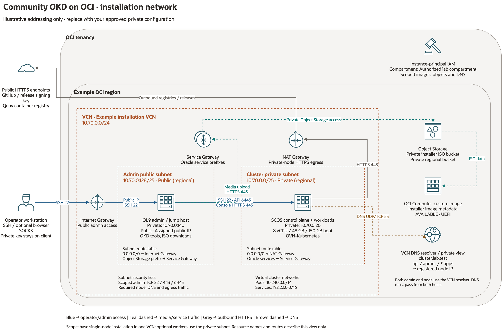

# Installation network

[Network diagram](diagrams/okd-installation-network.drawio) ·
[Full-size preview](diagrams/okd-installation-network.png)

This is an illustrative single-VCN installation. Addresses and names are examples;
use the private deployment profile for actual values. The restricted deployment
version and inventory remain in Git-ignored `internal_doc/`.

| Placement | Resource / role |
| --- | --- |
| Public subnet | OL9 admin/jump VM, accessed through an Internet Gateway and approved SSH rules. Downloads tools and prepares installation media. |
| Private subnet | New SCOS control-plane VM, initially running control-plane services and workloads. Optional SCOS workers use this subnet. |
| VCN gateways | Internet Gateway for public admin access; NAT Gateway for private-node public HTTPS egress; Service Gateway for the configured Oracle service prefixes. |
| Regional managed services | Object Storage for private ISO staging; OCI Compute custom image for manual VM creation; DNS resolver/private view and cluster zone. |
| Tenancy IAM | Instance-principal permissions scoped to the authorized compartment. |

The admin host reaches the private node locally in the VCN using SSH, the API
and console HTTPS. Nodes reach approved public registries through NAT. The
configured Object Storage/Oracle-service prefixes use the Service Gateway.
DNS must resolve API, internal API and wildcard apps names from both hosts.

The pod and service ranges are virtual cluster networks, separate from the OCI
subnets. This installation view covers local access and image preparation;
additional routed networks and cross-cluster connectivity have separate designs.

The Compute symbol labelled **custom image** represents image metadata in the
regional service. It is separate from the running VM inside the private subnet.

See [network/security prerequisites](installation.md#network-preparation) and
[DNS and readiness checks](operations.md).
